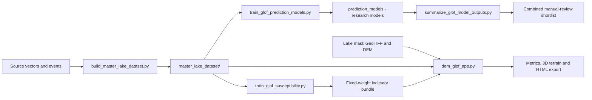

# System architecture

## System purpose

The system is a local, file-based GLOF research workflow. It ingests supplied geospatial inventories and a historical event database, constructs a traceable master lake dataset, produces several research-ranking artifacts plus a lightweight susceptibility indicator, and presents a user-supplied lake mask in an interactive 3D Streamlit viewer.

There is no hosted database, API, authentication layer, or real-time event feed in the current setup.



## Components

| Layer | Main files | Responsibility |
|---|---|---|
| Ingestion and integration | `build_master_lake_dataset.py` | Reads GPKG/SHP/CSV sources, applies conservative spatial matching, links events, derives observations and features |
| Provenance store | `master_lake_dataset/` | CSV/JSON outputs that retain source IDs, raw attribute JSON, geometries, matching evidence, and events |
| Research modelling | `train_glof_prediction_models.py`, `glof_models_fixed.py` | Builds similarity, anomaly, survival, and supervised comparison artifacts. Outputs are research rankings, subject to their READMEs and limits |
| Model synthesis | `summarize_glof_model_outputs.py` | Converts model outputs to percentile review signals and writes the combined shortlist |
| UI-indicator training | `train_glof_susceptibility.py` | Computes causal historic trend, reference percentiles, and fixed feature weights; serialises the bundle |
| Prediction helper | `glof_predict.py` | Applies the fixed-weight 0–100 indicator to a complete feature row |
| DEM analytics | `dem_glof_viz.py` | Aligns raster inputs in local UTM, extracts mask/terrain metrics, makes a Plotly 3D view and standalone HTML |
| User interface | `dem_glof_app.py` | Streamlit upload, optional Copernicus DEM retrieval, inventory lookup, scoring, display, and download |

`main.py` is only a thin launcher; `dem_glof_app.py` is the functional Streamlit entry point.

## Data flow in the interactive viewer

1. The user uploads a georeferenced lake mask where positive pixels represent lake and optionally uploads a DEM. If enabled, the app retrieves the relevant Copernicus GLO-30 tile when no DEM is provided.
2. `dem_glof_viz.align()` crops around the mask and reprojects mask and DEM to the local UTM zone. The mask is resampled nearest-neighbour; the DEM bilinearly.
3. `analyse()` retains the largest connected lake component and derives area, perimeter, bounding-box dimensions, compactness, elevation, slope, and surrounding-terrain metrics.
4. The app can identify the nearest master lake by centroid using a `cKDTree` in `ESRI:102025`, within a user-set radius. It then derives history features using observations before the requested image year only. The user can instead provide history features manually or leave them absent.
5. The indicator bundle normalises each available model feature using its training-corpus fifth and ninety-fifth percentiles. Missing features receive neutral value 0.5. Weighted contributions form a 0–100 descriptive score.
6. The application shows the score, the user-configurable Low/Moderate/High class, key contributions, metric table, Plotly view, and a self-contained HTML export.

## Indicator bundle contract

`prediction_models_ui/model.joblib` contains a dictionary with `feature_cols`, per-feature `q05`/`q95`/median statistics, weights, a version label, and a calibration flag. The current bundle uses ten features and weights that sum to one:

| Feature group | Total weight |
|---|---:|
| area and perimeter | 0.14 |
| length, width, elongation, compactness | 0.26 |
| 1-year and 3-year area change | 0.28 |
| growth rate and causal long-term trend | 0.32 |

For a risk-increasing feature, `s = clip((x-q05)/(q95-q05), 0, 1)`. Compactness is inverted (`1-s`). The final score is `100 × Σ(weight × component score)`. This is a transparent rule-based indicator, not a statistical probability model. In particular, it has `validated_supervised_probability: false`.

## Boundaries, persistence, and security

- Processing is local except the optional public DEM download. The Streamlit app does not persist uploaded masks or DEMs to the project; it uses temporary files.
- The model bundle is deserialised with `joblib`; only use project-trusted bundles, because Python serialised objects are not safe from untrusted sources.
- Outputs are ordinary files, so reproducibility depends on preserving the input data, scripts, model bundle, and run metadata together.
- The web UI is an analysis aid, not a production warning service. It does not issue alerts, determine evacuation decisions, or model downstream exposure.

## Operational run order

```text
Build master data -> inspect validation and match QA -> train/summarise research models
                          -> train indicator bundle -> start Streamlit viewer
```

Typical commands from the repository root are `python build_master_lake_dataset.py`, `python train_glof_susceptibility.py`, and `streamlit run dem_glof_app.py`. Run the model-training scripts only after the master-data validation has been reviewed.
